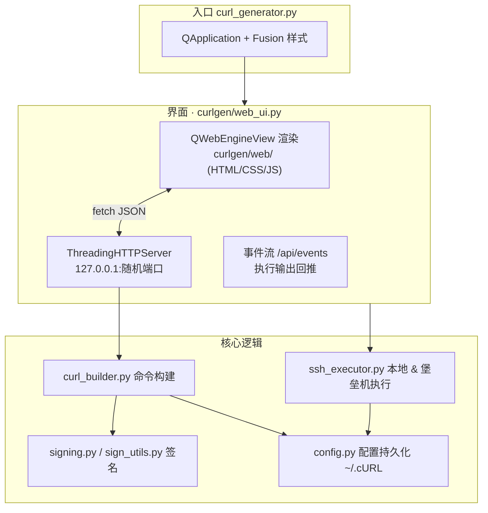

<div align="center">


# cURL Generator · 星轨控制台

**把接口调试、签名计算、堡垒机远程执行，收进一座深空座舱。**

*Generate · Sign · Execute — 一处搞定从 cURL 拼装到远程落地的全链路*

[](#)
[](#)
[](#)
[](#)
[](#)
[](#)
[](#)

</div>

---

## 📖 目录

- [一句话定位](#-一句话定位)
- [为什么需要它](#-为什么需要它)
- [核心特性](#-核心特性)
- [界面速览](#-界面速览)
- [架构总览](#-架构总览)
- [快速开始](#-快速开始)
- [目录结构](#-目录结构)
- [核心机制详解](#-核心机制详解)
  - [环境变量引用 `{{ref}}`](#1-环境变量引用-ref)
  - [签名计算](#2-签名计算javajava-兼容)
  - [GateShell 堡垒机远程执行](#3-gateshell-堡垒机远程执行)
  - [本地 API 服务](#4-本地-api-服务)
- [本地 HTTP API 一览](#-本地-http-api-一览)
- [配置持久化](#-配置持久化)
- [快捷键](#-快捷键)
- [打包发布](#-打包发布)
- [技术栈](#-技术栈)
- [常见问题 FAQ](#-常见问题-faq)
- [开发路线图](#-开发路线图)

---

## 🎯 一句话定位

**cURL Generator** 是一款面向 **接口联调 / 签名调试 / 远程运维** 场景的桌面工具：用图形界面拼装请求，一键生成可粘贴的 `curl` 命令；内置 **Java 风格签名算法**（MD5 / SHA256）；并通过 **GateShell 菜单式堡垒机** 把命令直接投递到内网目标机执行，输出实时回传。

> 从「手写 cURL」到「所见即所得的请求工作台」，它消灭了拼 URL、算签名、登堡垒机、贴命令这四步的重复劳动。

---

## 💡 为什么需要它

后端联调时的日常痛点，它逐一接管：

| 痛点 | cURL Generator 的解法 |
| --- | --- |
| 手拼 query / header / JSON body，格式一错就 400 | 结构化表单 + **一键美化/压缩**，自动拼装并转义 |
| 签名规则写死在文档里，每次都要手算 MD5/SHA256 | 环境里配好密钥与算法，**生成时自动算签、自动注入** |
| 不同环境（测试/预发/生产）域名、密钥来回切换 | **环境配置 + `{{变量}}` 引用**，切环境即切全量参数 |
| 内网机器不通外网，要在堡垒机上敲命令 | **堡垒机一键透传**，本地生成、远端执行、输出回显 |
| 常用请求每次重填 | **快捷请求分组** + **历史记录**，点一下即复活 |
| 工具界面丑、看久了累 | **深空座舱 / 晨雾** 双主题，深色护眼、发光主按钮 |

---

## ✨ 核心特性

<table>
<tr>
<td width="50%" valign="top">

### 🧭 请求工作台
- 方法选择（GET/POST/PUT/DELETE/PATCH/HEAD/OPTIONS），**方法联动页签**：POST 类自动切 Body、GET 类自动切 Query Params（手动切换、打开快捷请求、切换标签均生效）
- URL、Query Params、Headers 键值表编辑
- Body 支持 **JSON / Form Data / Raw Text / None**
- Body **美化 / 压缩** 一键切换
- Auth：Bearer Token / Basic Auth / API Key
- Options：`-k` 跳过 SSL、`-s` 静默、代理、超时

</td>
<td width="50%" valign="top">

### 🔐 签名与环境
- **MD5 / SHA256** 双算法，Java 风格大小写不敏感排序
- 签名参数名可自定义（默认 `sign`）
- 多环境配置（别名 / 密钥 / 算法 / 目标机）
- **`{{变量}}` 引用** + 编辑器内高亮 + 悬浮显示真实取值
- GET 系列签名自动落到 URL，其余注入 Body

</td>
</tr>
<tr>
<td width="50%" valign="top">

### 🖧 远程执行
- **本地直发**：「▶ 执行（本地）」由 Python 直接发起 HTTP 请求（不依赖系统 curl），自动跟随重定向，实时回传响应体，真实状态码 / 响应头 / 耗时尽收
- **SSH 远程**：代码预览（cURL 语言）右下角「🖧 SSH 请求」（仅当前环境开启 SSH 且预览为 cURL 时显示），二次确认后经堡垒机执行；远程 curl 自动追加 `-w` 尾注，Console 同样能解析出 HTTP 状态 / 耗时 / 体积
- **GateShell 堡垒机**密码认证菜单接入
- **多目标机**管理（标签 / 主机 / 端口 / 用户）
- 命令哨兵包裹，精确捕获退出码
- 超时保护、手动停止、连接测试

</td>
<td width="50%" valign="top">

### 🎨 体验与工程
- **7 套主题**：深空蓝 / 晨雾白 / 曜石黑 / 暗夜紫 / 墨绿森林 / 经典QQ / 阳光橙，菜单选择并持久记忆（与默认行情标的同存 `~/.cURL/ui_prefs.json`，重启后恢复上次所选）
- 快捷请求分组、历史记录、一键复制
- **多标签页**（Postman 式）：每个请求一个标签，脏标记 ●，互不惊扰；**Ctrl+S 覆盖保存**；关闭未保存标签时提醒「保存并关闭 / 直接关闭」
- **代码实时预览**：编辑即生成，无需手动点击；「代码预览」页签左侧纵向语言列表（栏内头部 « 按钮折叠为细轨道、» 展开，按钮不占用代码框空间，代码框随之延展充满），可切换 **cURL / Python / JavaScript / TypeScript / Node.js / Java / C# / Go / PHP / Rust** 十种语言（后端基于结构化请求生成，与实际发送一致），代码按语言做语法高亮（关键字 / 字符串 / 注释 / 数字 / 类型 / 函数分色），代码框右上角悬浮 ⧉ 图标一键复制当前代码；历史记录只记真实执行的请求
- **URL 地址栏高亮**：`{{变量}}` 与 query 参数键值染色，悬浮显示解析后的真实取值
- **Console 面板**（Postman 风格）：底部独立页签，每个请求标签各有一份记录；一次执行一条可折叠条目，展开可见 概览（状态行 / 耗时 / 体积）/ Request Headers·Body（实际发送报文）/ Response Headers·Body / cURL 等效命令 / 脚本日志，状态徽章按 2xx·3xx·4xx/5xx 着色；关闭标签或退出软件即清空
- 响应区：HTTP 状态行 / 耗时 / 体积元信息，JSON Pretty / Raw 切换，一键复制
- **JSON 工具**：响应框 / Console 详情里选中 JSON 字符串，右键「{ } JSON 工具」唤起编辑弹框——输入实时校验（含类型识别与错误定位），支持格式化 / 压缩 / 转义（bejson 风格不带外层引号）/ 去转义 / 一键复制
- **首页仪表盘**：关闭全部请求标签后自动呈现——统计卡片（快捷请求 / 分组 / 环境 / SSH 目标机 / 本次执行·成功率）、当月日历（农历、节日、节气，周一为首，今天高亮，法定节假日标「休」、调休补班标「班」，在线拉取失败自动回落内置数据；交易日选中后日历下方显示行情条：开盘价 / 收盘价（当天为实时现价）与涨跌幅，涨红跌绿，非交易日自动隐藏；并渲染选中月份的日 K 线图（内嵌 ECharts，蜡烛 + MA5/MA10/MA20 均线 + 成交量副图，红涨绿跌，图上方标注均线颜色图例，选中日高亮描边，hover 查看 OHLC 与均线值，点击蜡烛联动选中日，当月自动补上「今日形成中蜡烛」）；行情标的在行情条上下拉切换，左下角 📈 图标弹窗管理自选股（代码联网校验自动补全名称，「设为默认」指定默认展示标的并记忆，内置上证指数不可删））、**黄历详情**（宜 / 忌 / 干支 / 生肖 / 值神 / 冲煞 / 喜神财神方位 / 彭祖百忌，内嵌 lunar.js 完全离线）、**待办卡片**（右键日历任意一天即可创建，跟随选中日显示，可勾选完成 / 删除，当天无待办自动隐藏，持久化到本地）；「＋」或「新建请求」随时回到工作台
- 侧栏页签式（快捷请求 / 历史记录切换）+ 搜索 + 请求项右键（新标签打开 / 重命名 / 删除）+ 分组计数徽章；设置类入口收纳为底部图标行
- **一键导入** Postman Collection v2.1 / 环境变量 / OpenAPI 3（Apifox 可导出）：分组、鉴权、前后置脚本全映射，同名自动合并；环境变量导入为「自定义参数」，`{{变量名}}` 引用即刻生效
- KV 行启用勾选：禁用的 Header / Param 不进生成的命令
- **前后置脚本**：JavaScript 沙箱 + Postman 风格 `pm` API；**AI 智能生成**——脚本框右下角 ✨ AI 按钮唤起生成对话框，描述需求→生成预览→一键应用回填（OpenAI 兼容协议，内置通义 / DeepSeek / Kimi 预设，支持自定义中转站，Key 仅存本地）
- 按天滚动日志（保留 30 天）
- PyInstaller 单文件打包，免环境运行

</td>
</tr>
</table>

---

## 🖥 界面速览

**新版 · 星轨控制台（Aurora）** —— 由 QWebEngineView 渲染的原生 Web 界面：

```
┌──────────────┬──────────────────────────────────────────────────────────┐
│  cURL Gen    │  [GET ▾]  https://api.example.com/v1/resource   [生产 ▾]  │
│  星轨控制台   ├──────────────────────────────────────────────────────────┤
│              │  复制 保存请求 ▶执行(本地) ■停止                就绪      │
│ ⚡ 请求构建   ├───────────────────────────────┬──────────────────────────┤
│ 🌐 环境管理   │ [Headers][Params][Body][Auth] │  cURL 预览（实时生成）     │
│ 🖧 SSH 设置   │ ┌───────────────────────────┐ │  curl -X POST \           │
│ 🌓 切换主题   │ │ key        │ value        │ │    -H "Content-Type:..."  │
│ 🤖 AI 设置   │ │ X-Sign     │ {{appKey}}   │ │    -d '{...}'  [🖧SSH请求]│
│              │ └───────────────────────────┘ │                          │
│ 快捷请求 ▸    ├───────────────────────────────┴──────────────────────────┤
│  · 商户余额   │ [响应] [代码预览] [Console]              200 OK 0.24s    │
│  · 下单接口   │  { "code": 0, ... }                                     │
│ 历史记录 ▸    │  Console：▸16:30 POST /v1/pay  [成功 exit 0·0.24s·64 B] │
│ ● 本地模式   │    每次执行一条可折叠记录，展开看请求/响应/cURL 详情        │
└──────────────┴──────────────────────────────────────────────────────────┘
```

> 左侧导航四大区块：**请求构建 / 环境管理 / SSH 设置 / 切换主题**，底部常驻 **快捷请求** 与 **历史记录**，以及实时 **连接状态徽标**。

---

## 🏛 架构总览



**设计原则：**

- **核心与界面解耦**：命令构建、签名、执行三大逻辑都在纯 Python 模块里，与界面完全分离，可独立测试。
- **UI 走 Web 化路线**：把界面交给浏览器引擎，获得远超传统 Qt 控件的动效与排版自由度；Python 端只做数据与执行，通过本地 HTTP + 事件流通信。

---

## 🚀 快速开始

### 环境要求

| 依赖 | 版本 | 说明 |
| --- | --- | --- |
| Python | 3.8+ | 建议 3.10 ~ 3.11 |
| PyQt5 | 5.15+ | GUI 基础（必装） |
| PyQtWebEngine | 5.15+ | 星轨控制台渲染引擎（必装） |
| paramiko | 2.x / 3.x | SSH 堡垒机远程执行（选装） |
| pyinstaller | 5+ | 仅打包时需要 |

### 安装依赖

```bash
pip install PyQt5 PyQtWebEngine paramiko
```

### 源码运行

```bash
python curl_generator.py
```

### 直接使用发行版

下载 `dist/CurlGenerator.exe`，双击即用 —— 无需安装 Python 环境。

---

## 📁 目录结构

```text
buildCurl/
├── curl_generator.py          # 🚪 程序入口
├── CurlGenerator.spec         # 📦 PyInstaller 打包配置
├── logo.png                   # 🎨 应用图标 / 品牌标识
├── README.md                  # 📖 本文档
├── dist/
│   └── CurlGenerator.exe      # 🎁 打包成品（单文件）
└── curlgen/                   # 🧩 核心包（__version__ = 2.0.0）
    ├── __init__.py            # 版本号
    ├── config.py              # 💾 路径常量 & JSON 持久化（~/.cURL）
    ├── logging_setup.py       # 📝 按天滚动日志（保留 30 天）
    ├── signing.py             # 🔐 签名入口（MD5 / SHA256）
    ├── sign_utils.py          # 🔐 Java 风格排序 / SHA256 实现
    ├── curl_builder.py        # 🏗 cURL 命令构建与结构化请求解析
    ├── code_gen.py            # 🧬 多语言代码生成（Python/JS/Java/Go/Rust 等 10 种）
    ├── http_executor.py       # ⚡ 本地直发 HTTP（urllib，自动跟随重定向）
    ├── ssh_executor.py        # 🖧 GateShell 堡垒机远程执行
    ├── web_ui.py              # 🌌 主窗口（星轨控制台 + 本地 API）
    └── web/                   # 🌐 前端资源（经本地 HTTP 服务加载）
        ├── index.html         # 结构骨架
        ├── app.css            # 样式（深/浅双主题令牌）
        ├── app.js             # 交互逻辑（高亮 / 悬浮 / 事件流 / 仪表盘）
        ├── logo.png
        └── vendor/
            └── lunar.js       # 农历黄历库（lunar-javascript, MIT，离线内嵌）
```

---

## 🔬 核心机制详解

### 1. 环境变量引用 `{{ref}}`

在任何文本字段（URL、Header 值、Body、代理）中写 `{{变量名}}`，生成时会替换为 **当前环境** 下配置的 `自定义变量` 值。变量定义在 **环境配置管理** 的「自定义变量」列，格式为 `k1=v1; k2=v2`。

**替换规则**（与 Java 后端保持完全一致）：

```python
# curlgen/curl_builder.py
for k, v in var_map.items():
    text = text.replace("{{" + k + "}}", v)   # 原始键名精确匹配，不做 trim
```

**编辑器内的可视化增强**（新版 UI 独有）：

- ✅ **实时高亮**：所有 `{{...}}` 会被染色加底，一眼可辨。
- ✅ **悬浮取值**：鼠标悬停到引用上，气泡直接显示该变量 **在当前环境下将替换成的真实值**；未定义的引用显示 `（未定义）`，避免"看着像配了其实没配"的坑。
- 🧠 高亮层由透明 `textarea` + 下层 `pre` 覆盖层共同实现，字体度量严格对齐，输入体验与看板渲染两不误。

```text
输入:  https://{{host}}/api/pay?appKey={{appKey}}
生产环境:  host=api.prod.com  appKey=AK2026  →
实际:  https://api.prod.com/api/pay?appKey=AK2026
```

### 2. 签名计算（Java 兼容）

签名字符串构造遵循 Java 侧约定，**键名不区分大小写排序**，过滤空值与签名字段本身：

```text
sorted(key1=value1&key2=value2&...) + "key={secret}"
```

| 算法 | 实现 | 输出 |
| --- | --- | --- |
| `MD5` | `md5(sign_str).hexdigest().upper()` | 32 位大写十六进制 |
| `SHA256` | Java `MessageDigest("SHA-256")` 风格 | 64 位大写十六进制 |

**签名值落点：**

- `GET / HEAD / OPTIONS`：签名作为 URL 参数追加（`&sign=...`）。
- 其他方法：签名 **并入 Body**（JSON 注入字段、Form 追加行、Raw 追加 `&sign=`）。

签名计算会合并 **Query 参数 + Body 参数**（JSON/Form/Raw 自动解析展开），保证前后端参与的字段集合一致。接口预览区会实时显示 `签名: XXXXXXXX`。

### 3. GateShell 堡垒机远程执行

工具对接的是 **GateShell 菜单式堡垒机**（协议标识 `SSH-2.0-SSHD_*`）。它与普通 OpenSSH 跳板机有 **三处根本差异**，本项目已针对性适配：

| 差异 | 现象 | 本项目对策 |
| --- | --- | --- |
| ❌ 不支持 SSH `exec` | 通道被立即关闭，`exit_status=-1` | 放弃 exec，改用交互式 shell |
| ❌ 不做原始 TCP 透传 | `direct-tcpip` 回连指纹与堡垒机自身一致（接管而非转发） | 放弃嵌套隧道，走菜单 |
| ✅ 唯一入口是交互式菜单 | `invoke_shell()` 得到 TUI 授权机列表 | **菜单 → 搜索 → 回车进入目标机** |

**执行流程：**

```text
密码认证 → invoke_shell 进入菜单
        → 输入 /{ip} 搜索目标机（逐字符输入，防吞键）
        → 回车进入目标机 shell（echo 哨兵确认可交互）
        → 哨兵包裹执行命令:
          echo __CG_S_xxx__; {cmd} 2>&1; __ec=$?; echo; echo __CG_E_xxx__$__ec
        → 解析 START/END 双哨兵，提取真实输出 + 精确退出码
```

**关键工程细节：**

- **双哨兵独占成行匹配**：避免命中终端回显的那行命令；`END` 前补一个换行，防止无尾换行的响应（如 JSON）粘连。
- **stderr 合并 stdout**：交互式 shell 两者都在 pty 上，无法分离。
- **ANSI 序列剥离**：正则清理 OSC / CSI / 字符集 / 单字符控制码，`\r` 归一为 `\n`。
- **远端 curl 自动加 `--max-time`**：防止目标机进程挂死（检测到 `curl` 且未设超时会自动追加）。
- **多目标机**：`targets[{label, host, port, user}]`，环境配置里按 **标签** 选用目标机。
- **连接测试**：可只测堡垒机登录，也可延伸到目标机执行 `hostname` 验证。
- **可停止 / 超时**：`stop_event` 贯穿读写，硬超时上限 120s。

### 4. 本地 API 服务

星轨控制台采用 **"Web 前端 + 本地 API"** 架构：

- Python 端启动 `ThreadingHTTPServer` 于 `127.0.0.1` **随机端口**，只监听本机，天然安全。
- 页面通过 `window.API_BASE` 与后端通信，执行输出经 **`/api/events` 事件流** 增量拉取刷新。
- 页面（含 ECharts / lunar.js 等本地资源）由同一 HTTP 服务按白名单提供，`QWebEngineView` 直接 `load()` 本地地址——避开 `setHtml` 的体积上限（内嵌大资源会超限黑屏），同时完成 `__PORT__` 占位符替换。

> ⚠️ **改前端后需重启应用**：`app.css` / `app.js` / `index.html` 的改动在下次启动时才会加载生效。

**前端兼容注意**：内置 QtWebEngine 的 Chromium 版本较老，前端 **避免使用 `inset` 简写、`color-mix()`** 等新特性（代码中已用兼容写法替代）。

---

## 🌐 本地 HTTP API 一览

| 方法 | 路由 | 说明 |
| --- | --- | --- |
| `GET` | `/api/state` | 全量状态（logo / 环境 / 快捷请求 / SSH 配置 / 就绪标记） |
| `GET` | `/api/envs` | 环境配置列表 |
| `GET` | `/api/ssh` | SSH 配置（不含密码） |
| `GET` | `/api/ssh_targets` | 目标机列表 |
| `GET` | `/api/history` | 生成历史 |
| `GET` | `/api/events?since=N` | 事件流增量（执行输出 / 通知 / 测试结果） |
| `GET` | `/api/holidays?year=YYYY` | 全年节假日 / 调休映射（代理 timor.tech，离线回落内置数据） |
| `GET` | `/api/astock?date=YYYY-MM-DD&code=sh000001` | 某日行情（历史代理东方财富/腾讯日 K，当天代理腾讯实时；非交易日返回 `trading=false`；code 支持自选股） |
| `GET` | `/api/astock_kline?month=YYYY-MM&code=sh000001` | 整月日 K + `prev_closes` 月前收盘价（供 MA20 起点）；东财→腾讯双源自愈，当月自动用实时行情补上「今日形成中蜡烛」 |
| `GET` | `/api/stocks` | 自选股列表（内置上证指数） |
| `POST` | `/api/ui_prefs` | 保存 UI 偏好（`theme` / `stock`，白名单合并写入 `~/.cURL/ui_prefs.json`） |
| `GET` | `/api/stock_lookup?code=600519` | 联网校验股票代码并补全名称（6 开头=沪 / 0、3 开头=深 / 支持 sh、sz 前缀） |
| `POST` | `/api/stocks` | 自选股增 / 删（`action=add\|del`，持久化到 `~/.cURL/stocks.json`） |
| `GET` | `/api/todos` | 待办列表 |
| `POST` | `/api/todos` | 待办增 / 勾选 / 删（`action=add\|toggle\|del`） |
| `POST` | `/api/generate` | 生成 cURL 命令并返回签名预览（`lang=python` 等时返回对应语言代码） |
| `POST` | `/api/execute` | 执行请求（`mode=local` / `ssh`） |
| `POST` | `/api/stop` | 停止当前执行 |
| `POST` | `/api/copy` | 写入系统剪贴板 |
| `POST` | `/api/save_request` | 保存/更新快捷请求 |
| `POST` | `/api/delete_request` | 删除快捷请求 |
| `POST` | `/api/clear_history` | 清空历史 |
| `POST` | `/api/save_envs` | 保存环境配置 |
| `POST` | `/api/save_ssh` | 保存 SSH 配置 |
| `POST` | `/api/test_ssh` | 触发连接测试（异步，结果走事件流） |

---

## 💾 配置持久化

所有用户数据落在 **当前登录用户主目录** 的 `~/.cURL/`（Windows 为 `C:\Users\<你>\.cURL\`），与程序安装位置无关，升级/搬迁不丢配置。

| 文件 | 内容 |
| --- | --- |
| `env_configs.json` | 环境配置（别名 / 密钥 / 算法 / 参数名 / 变量 / 目标机） |
| `ssh_config.json` | 跳板机信息 + 多目标机列表 |
| `saved_requests.json` | 快捷请求分组与内容 |
| `sign_configs.json` | 签名相关配置 |
| `logs/curlgen.log` | 按天滚动日志，保留 30 天 |

> 🔒 **安全提醒**：签名密钥与 SSH 密码以明文存于 `~/.cURL/` 本地配置中，**请勿将该目录提交到任何仓库或共享**。

---

## ⌨️ 快捷键

| 快捷键 | 功能 |
| --- | --- |
| `Ctrl + Enter` | 生成 cURL |
| `Ctrl + Shift + Enter` | 执行请求 |

---

## 📦 打包发布

使用 PyInstaller 打包为 **单文件 exe**：

```bash
pyinstaller CurlGenerator.spec
```

`CurlGenerator.spec` 关键配置：

- **datas**：`curlgen/web` 前端资源 + `logo.png`
- **hiddenimports**：`PyQt5.QtWebEngineWidgets`、`PyQt5.QtWebChannel`（避免被静态分析漏掉）
- **单文件 / 无控制台 / UPX 压缩 / 图标 `logo.png`**

产物输出至 `dist/CurlGenerator.exe`。

---

## 🧰 技术栈

<div align="center">

| 层级 | 技术 |
| :---: | :--- |
| 语言 | Python 3 |
| GUI 框架 | PyQt5（Fusion 样式） |
| 新版渲染引擎 | QtWebEngine / Chromium |
| 前端 | 原生 HTML5 + CSS3 + Vanilla JS（零框架） |
| 网络 / 执行 | http.server、subprocess、socket |
| SSH | paramiko（堡垒机交互式会话） |
| 签名 | hashlib（MD5 / SHA256，Java 风格） |
| 打包 | PyInstaller |

</div>

---

## ❓ 常见问题 FAQ

<details>
<summary><b>启动提示缺少 PyQtWebEngine？</b></summary>

界面由 QtWebEngine 渲染，请安装：`pip install PyQtWebEngine`。使用打包好的 `dist/CurlGenerator.exe` 则无此问题。
</details>

<details>
<summary><b>改了 app.js / app.css 为什么不生效？</b></summary>

前端资源在应用启动时经本地 HTTP 服务加载进页面，**必须重启程序** 才会加载新内容。
</details>

<details>
<summary><b>SSH 执行报"不是 GateShell 类型堡垒机"？</b></summary>

本工具针对 **菜单式堡垒机** 适配。若你的跳板机是标准 OpenSSH 且支持 `exec`，并不需要此处的菜单流程，可在其 shell 内直接使用系统 `ssh`。
</details>

<details>
<summary><b>提示"授权列表中没有某 IP"？</b></summary>

目标机必须已在堡垒机侧 **授权给你的账号**。可在 SSH 设置里点「测试目标机」，或查看菜单中的授权机器总数。
</details>

<details>
<summary><b>`{{变量}}` 没有被替换？</b></summary>

请确认：① 已在「环境管理」中为 **当前选中的环境** 配好该变量；② 变量名拼写与 `{{}}` 内完全一致（区分大小写、含空格）；③ 顶部环境下拉确实选中了对应环境。悬停引用时气泡显示 `（未定义）` 即说明未命中。
</details>

<details>
<summary><b>配置存在哪？换电脑怎么迁移？</b></summary>

全部在 `~/.cURL/`。拷贝该目录到新机器同名路径即可无缝迁移。
</details>

---

## 🗺 开发路线图

- [ ] 环境变量 `{{ref}}` 支持默认值与嵌套引用
- [ ] 请求集合导入 / 导出（Postman / HAR）
- [ ] 响应 JSON 结构化折叠视图
- [ ] 签名算法扩展（HMAC 系列）
- [ ] 多语言界面（EN / 中）

---

<div align="center">

**cURL Generator · 星轨控制台** &nbsp;v2.0.0

用一座座舱，装下接口调试的全部星光。⭐

<sub>Made with PyQt5 + QtWebEngine · 深空座舱 / 晨雾 双主题</sub>

</div>